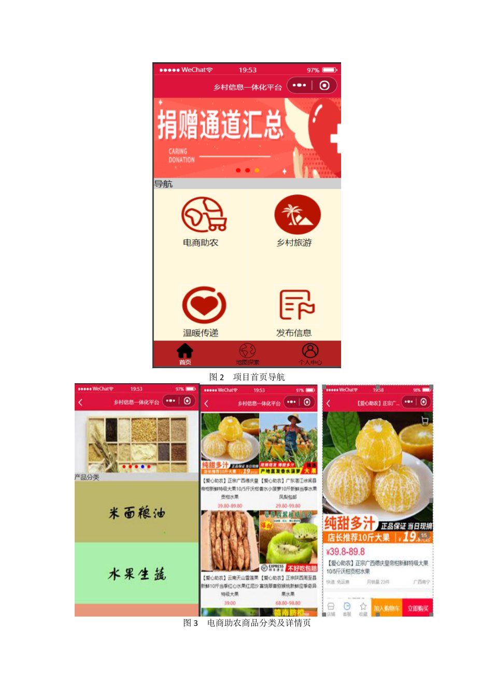
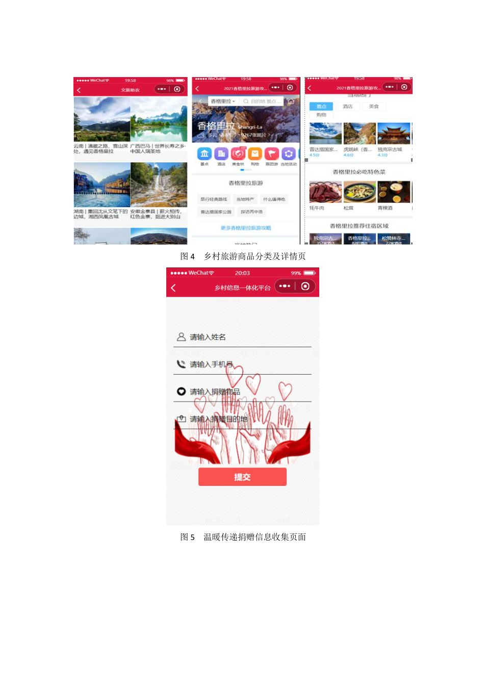
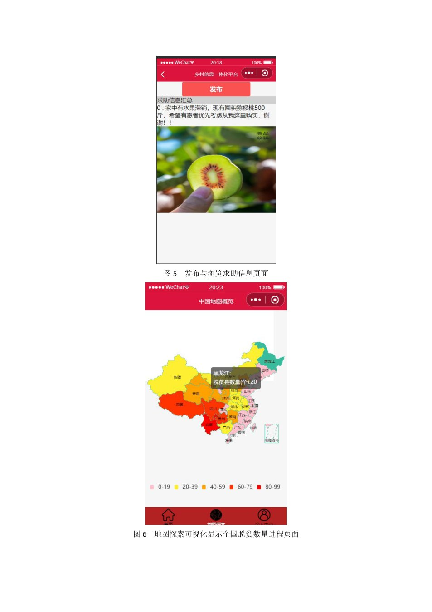
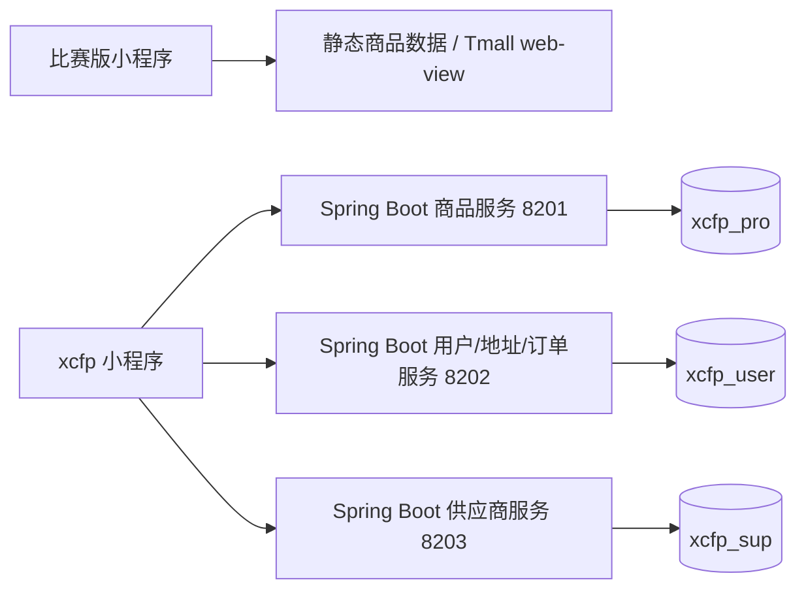

# 电商助农平台 · 比赛原型 → 前后端续作

> 2021 年“电商助农”项目的两阶段整理：原生微信小程序电商原型 + 后续 Spring Boot/MySQL 前后端平台。  
> 同一项目的两个迭代，不是一个已经打通的完整生产系统。



## 项目简介

这个仓库把 2021 年的两段开发资料合并在一起，方便后续继续做增量修改：

| 阶段 | 目录 | 时间 | 内容 | 实际边界 |
|---|---|---|---|---|
| 比赛版小程序 | `competition-miniprogram/` | 2021.03-04 | 原生微信小程序：乡村信息首页、电商助农商品分类/详情、乡村旅游、地图探索、个人中心、求助/反馈等 | 商品是静态数据，购买通过 Tmall `<web-view>` 跳转；没有 Python/MySQL 后端；登录/云数据库未完成 |
| xcfp 前后端续作 | `platform/` | 2021.10-11 | 原生小程序 + Spring Boot 多模块 + MyBatis-Plus + MySQL：商品、用户、收货地址、订单 | 没有真实微信支付（下单占位）；数据库 schema 是重建的最小版本，不是原始 dump |

比赛版获得 **2021 第七届上海财经大学创新创业大赛/第七届中国国际“互联网+”校内赛 三等奖**（证书见 `docs/awards/`）。另据项目材料记录，项目还获得 2021 上海市大学生计算机应用能力大赛优胜奖；软件著作权证书由作者保存，仓库不附证书、不写注册号。

## 效果截图

| 首页 + 商品 | 乡村旅游/捐赠 | 地图 + 个人中心 |
|---|---|---|
|  |  |  |

截图来自 2021 年作品小结（历史截图）；当前 DevTools 里可能因云环境/外链失效而不同。xcfp 续作没有保留当年的界面截图，代码和运行方式见 `platform/`。

## 我的工作

- **比赛版小程序**：原生 WXML/WXSS/JS 页面、电商助农分类/详情、地图/旅游/政策等内容整理；补齐页面注册和导航，让已有页面更容易继续开发。
- **xcfp 续作**：Spring Boot 多模块后端（商品、用户、收货地址、订单）与 MySQL 模型，配合小程序的浏览、登录注册、地址管理和下单流程。
- **整理**：清理硬编码数据库密码/API key/真实 AppID，补充脱敏文档、SQL schema、运行说明和历史截图。

这是团队项目；设计文档/答辩 PPT 中的个人信息已脱敏，原始报名表、签名页等没有发布。

## 技术栈

- 微信小程序：原生 WXML/WXSS/JavaScript/JSON，Vant Weapp/WeUI/Wux 组件，ECharts（地图页）。
- 后端：Java 8、Spring Boot 2.2、MyBatis-Plus、MySQL、Swagger2。
- 数据：MySQL 8（本地）；`sql/schema.sql` 为按实体/旧 DDL 重建的最小 schema。



## 目录

```text
agri-ecommerce-platform/
├─ competition-miniprogram/    # 2021 计赛 3-8 原生小程序（完整页面保留）
├─ platform/
│  ├─ miniprogram/             # xcfp 小程序前端
│  └─ backend/                 # xcfp Spring Boot 多模块后端
├─ sql/                        # schema + seed（重建的最小版本）
├─ docs/
│  ├─ design/                  # 脱敏设计说明书/作品小结/答辩 PPT
│  ├─ screenshots/             # 比赛版历史截图
│  └─ awards/                  # 2021 三等奖证书图像
└─ scripts/validate-miniprogram.mjs
```

## 运行

### 比赛版小程序

```bash
# 微信开发者工具 → 导入项目 → 选择 competition-miniprogram/
# AppID 使用 touristappid，或填你自己的测试 AppID
node scripts/validate-miniprogram.mjs competition-miniprogram
```

项目保留了 `miniprogram_npm/`。云登录/注册需要在 `app.js` 和登录页配置真实云环境；快递查询需要把 `YOUR_APISHOP_API_KEY` 换成你自己的 key。

### xcfp 前后端

```bash
# 1. 建库 + 演示数据
mysql -u root -p < sql/schema.sql
mysql -u root -p < sql/seed.sql

# 2. 后端（JDK 8 + Maven）
cd platform/backend
export XCFP_DB_USER=root
export XCFP_DB_PASSWORD=change-me
export XCFP_PRO_DB_URL='jdbc:mysql://localhost:3306/xcfp_pro?characterEncoding=utf-8&useSSL=false&serverTimezone=Asia/Shanghai'
export XCFP_SUP_DB_URL='jdbc:mysql://localhost:3306/xcfp_sup?characterEncoding=utf-8&useSSL=false&serverTimezone=Asia/Shanghai'
export XCFP_USER_DB_URL='jdbc:mysql://localhost:3306/xcfp_user?characterEncoding=utf-8&useSSL=false&serverTimezone=Asia/Shanghai'
mvn -B -DskipTests clean package
java -jar service/service_proinfo/target/service_proinfo-1.0.0.jar
java -jar service/service_user/target/service_user-1.0.0.jar
java -jar service/service_sup/target/service_sup-1.0.0.jar

# 3. 小程序：导入 platform/miniprogram/，启动本地服务后测试
```

演示数据：用户 `13900000000` / `demo123`（虚构）；商品/供应商/地址/订单见 `sql/seed.sql`。三服务端口 8201/8202/8203；`utils/config.js` 默认指向 localhost。MySQL 8 + 旧 connector 可能需要 `mysql_native_password` 演示账号或升级 connector，详见 `platform/backend/README.md`。

## 已知未完成项

- 比赛版没有真实后端；登录/注册/云数据库、外部商品跳转、部分 2021 外链图片需要继续修。
- xcfp 没有真实支付；订单只是写库；没有完整原始数据库 dump、自动化测试和部署配置。
- 两个阶段不是同一套前后端；README/简历按实际写，不把比赛版说成有 Python/MySQL 后端。
- 本机没有软件著作权证书扫描件；仓库不附证书；简历中的软著表述由作者自行确认。

## 文档

- [设计说明书（脱敏）](docs/design/design-spec.pdf)
- [作品小结（脱敏）](docs/design/work-summary.pdf)
- [答辩 PPT（脱敏）](docs/design/pitch-deck.pdf)
- [SQL 说明](sql/README.md)
- [文档/截图说明](docs/README.md)

## 使用说明

课程/竞赛项目展示，**未添加 LICENSE**；未经许可请勿商用。仓库内演示电话、密码、AppID、云环境均为占位/虚构值。
