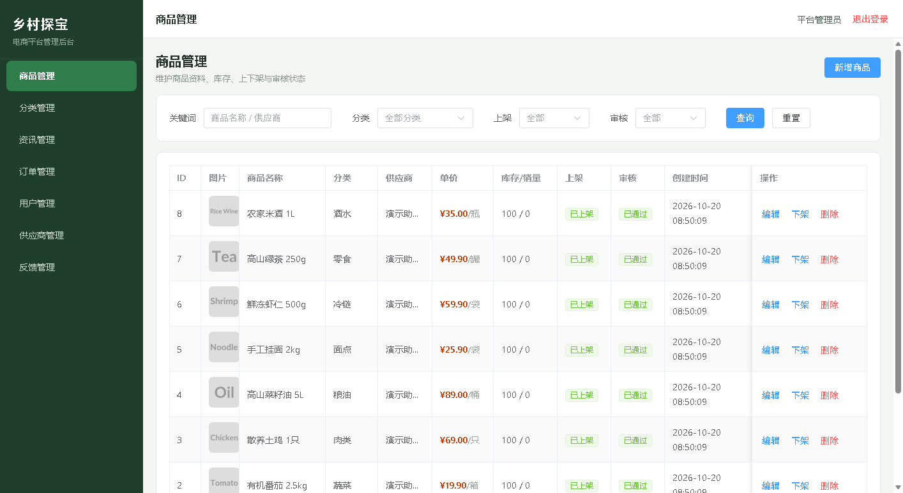
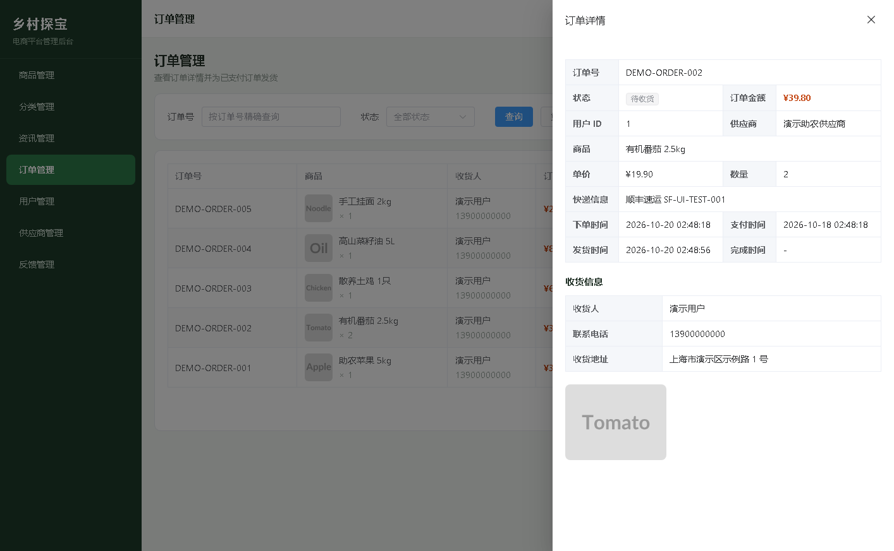
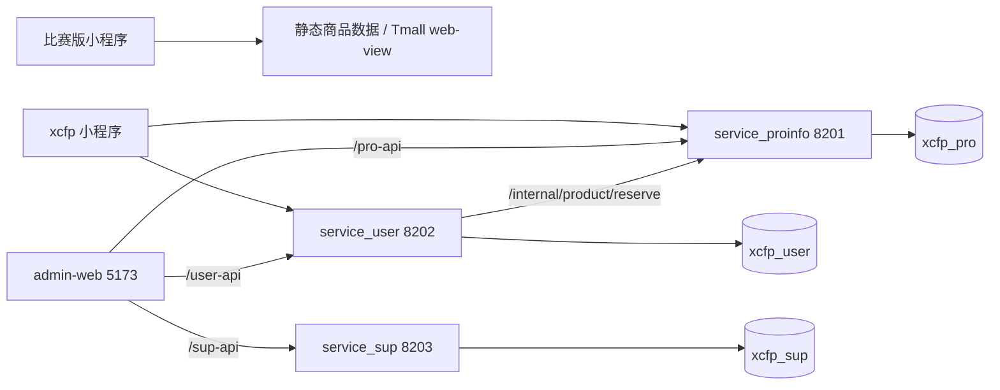
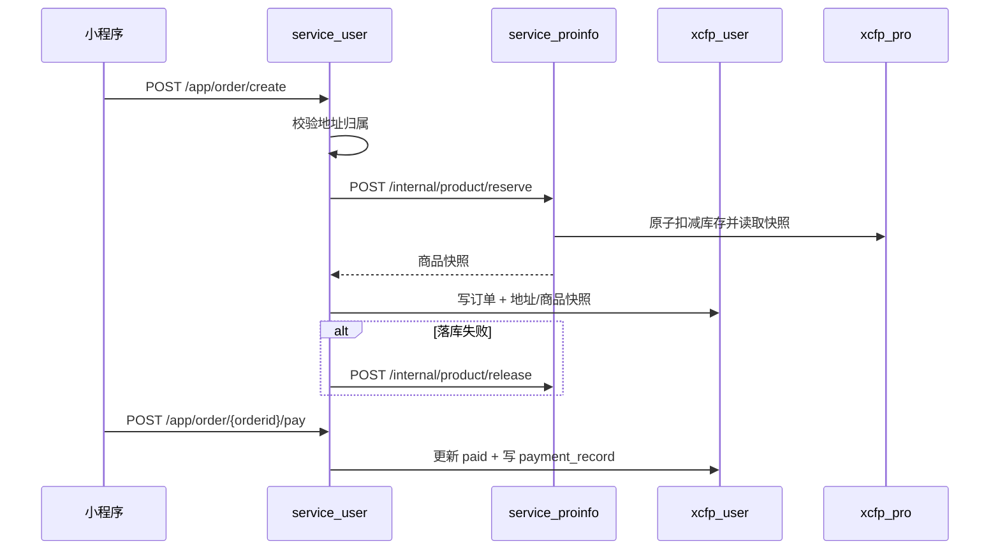

# 电商助农平台 · 全栈电商系统

<p align="center">
  <strong>原生微信小程序 + Spring Boot 三服务 + Vue 3 管理后台</strong><br/>
  认证 · 商品 · 地址 · 订单 · 模拟支付 · 管理端 · 库存一致性
</p>

<p align="center">
  
  
  
  
  
</p>

> 从 2021 年“电商助农”比赛原型演进而来的可运行全栈项目。
> `competition-miniprogram/` 保留历史原型；`platform/` 实现了完整的前后端闭环。
>
> **当前状态**：本地主流程已跑通；后端冒烟测试 83 项通过，管理后台与小程序均已完成运行验证。

## 目录

- [项目亮点](#项目亮点)
- [界面预览](#界面预览)
- [项目背景](#项目背景)
- [核心功能](#核心功能)
- [技术架构](#技术架构)
- [目录结构](#目录结构)
- [关键设计](#关键设计)
- [项目规模与验证](#项目规模与验证)
- [快速开始](#快速开始)
- [演示账号](#演示账号)
- [接口约定](#接口约定)
- [已知限制](#已知限制)
- [文档](#文档)

## 项目亮点

- **完整业务闭环**：注册/登录 → 浏览商品 → 收货地址 → 下单 → 模拟支付 → 管理端发货 → 确认收货；另含取消订单、反馈、资讯与供应商管理。
- **三服务 + 三库架构**：商品、用户/订单、供应商分别独立部署，按业务边界拆分数据库，避免单体应用的数据耦合。
- **安全设计落地**：JWT 跨服务验签、BCrypt 密码、`/app/**` 与 `/admin/**` 分角色鉴权、资源归属校验、内部服务令牌，敏感字段不参与序列化。
- **库存一致性**：下单通过内部接口原子扣减库存，服务端计算金额，失败自动补偿；支付/取消操作幂等，避免重复扣减或回补。
- **可替换支付**：`PaymentGateway` 抽象 + `MockPaymentGateway` 默认实现，支付流水落库；真实微信支付只需替换网关实现。
- **工程化交付**：`reset/schema/seed` 可重建数据库，83 项后端冒烟检查，管理后台可构建、可回归，小程序有静态校验与实机运行验证。

## 界面预览

| 管理后台 · 商品管理 | 管理后台 · 订单详情 |
|---|---|
|  |  |

> 截图来自本地演示数据，商品与资讯图片使用占位图。

## 项目背景

这个仓库把 2021 年“电商助农”项目的两段开发资料合并在一起，方便继续做增量开发：

| 阶段 | 目录 | 时间 | 内容 | 边界 |
|---|---|---|---|---|
| 比赛版小程序 | `competition-miniprogram/` | 2021.03-04 | 原生微信小程序：乡村信息首页、电商助农商品分类/详情、乡村旅游、地图探索、个人中心、求助/反馈等 | 商品是静态数据，购买通过 Tmall `<web-view>` 跳转；没有自建后端；登录/云数据库未完成 |
| xcfp 平台 | `platform/` | 2021.10-11 起续作 | 原生小程序 + Spring Boot 三服务 + MySQL + Web 管理后台：认证、商品/分类/资讯、地址、订单、模拟支付、反馈、供应商 | 已打通本地主流程；未接真实微信支付/图片上传/细粒度 RBAC |

比赛版获得 **2021 第七届上海财经大学创新创业大赛/第七届中国国际“互联网+”校内赛 三等奖**（证书见 `docs/awards/`）。另据项目材料记录，项目还获得 2021 上海市大学生计算机应用能力大赛优胜奖；软件著作权证书由作者保存，仓库不附证书、不写注册号。

比赛版为团队作品；`platform/` 是在比赛版之后的续作与工程化完善。本仓库保留可运行的实现、SQL 重建脚本和验证脚本。

<details>
<summary>2021 比赛版历史截图</summary>


</details>

## 核心功能

**小程序用户端**

- 注册/登录、JWT 登录态、个人资料与密码修改
- 首页分类筛选、商品分页、下拉刷新、商品详情与库存校验
- 收货地址新增/编辑/删除/设默认
- 下单（服务端定价、原子扣库存）、模拟支付、取消、确认收货
- 订单列表/详情，状态筛选，商品快照展示
- 资讯列表/详情、意见反馈与回复查看

**Web 管理后台**（`platform/admin-web/`）

- 管理员登录、路由守卫、令牌失效自动回登录页
- 商品新增/编辑/上下架/审核/删除
- 分类、资讯新增/编辑/删除
- 订单查询、详情抽屉、发货
- 用户列表、供应商新增/编辑/审核/启停/删除、反馈回复

## 技术架构



| 服务 | 端口 | 数据库 | 职责 |
|---|---|---|---|
| `service_proinfo` | 8201 | `xcfp_pro` | 商品、分类、资讯；库存预占/释放内部接口 |
| `service_user` | 8202 | `xcfp_user` | 用户/管理员认证、地址、订单、模拟支付、反馈 |
| `service_sup` | 8203 | `xcfp_sup` | 供应商资料、审核、启停 |

### 技术栈

| 层面 | 技术 |
|---|---|
| 小程序 | 原生 WXML/WXSS/JavaScript（ES modules）、微信开发者工具 |
| 后端 | Java 8、Spring Boot 2.2、MyBatis-Plus 3.3、MySQL 8、Swagger2、JJWT、BCrypt、Maven |
| 管理后台 | Vue 3、Vite 5、Element Plus、Pinia、Vue Router、Axios |
| 数据与验证 | MySQL 8 三库、Node.js 冒烟/静态校验脚本 |

## 目录结构

```text
agri-ecommerce-platform/
├─ competition-miniprogram/    # 2021 比赛版小程序（历史归档，未改动）
├─ platform/
│  ├─ miniprogram/             # 原生小程序用户端
│  ├─ admin-web/               # Vue 3 管理后台
│  └─ backend/                 # Spring Boot 多模块后端
├─ sql/                        # reset/schema/seed
├─ docs/                       # 设计文档、历史截图、证书
└─ scripts/
   ├─ smoke-test.mjs           # 后端主流程冒烟测试
   └─ validate-miniprogram.mjs # 小程序页面/导航静态校验
```

## 关键设计

> 更完整的面试讲法、常见追问和代码索引见 [关键设计与面试高频考点](docs/interview-notes.md)。

### 认证与权限

- JWT 由 `service_user` 统一签发，三个服务共享 `XCFP_JWT_SECRET` 本地验签；令牌包含用户/管理员 ID、角色和过期时间。
- `/app/**` 需要 USER 令牌，`/admin/**` 需要 ADMIN 令牌，`/internal/**` 只接受共享 `X-Internal-Token`。
- 未登录返回业务码 `208` + HTTP 401；路径/角色不匹配返回 `209` + HTTP 403；资源归属不符返回响应体 `209`（统一异常处理，HTTP 通常为 200）。
- 用户地址、订单等资源强制从 token 取用户 ID 并校验归属，不信任请求体中的 `userid`。
- 密码使用 BCrypt；兼容旧明文密码并在登录成功时自动升级。用户密码、供应商密码、`signkey/secode` 等敏感字段不参与序列化。

### 订单与库存

订单状态机：`created`（待付款）→ `paid`（待发货）→ `shipped`（待收货）→ `completed`（已完成）；`created` 可取消为 `cancelled`。

创建订单时，用户服务先校验地址归属，再调用商品服务的内部接口完成“校验 + 原子扣减 + 返回商品快照”。扣减 SQL 使用 `stock >= ?` 条件更新，避免先查后扣的竞态；订单落库失败会调用释放接口补偿。订单金额由服务端按商品快照计算，客户端不能指定价格。



### 支付抽象

`POST /app/order/{orderid}/pay` 当前走模拟支付：

1. 校验订单归属与 `created` 状态；
2. 调用 `PaymentGateway`，默认实现为 `MockPaymentGateway`；
3. 更新订单为 `paid` 并写入 `payment_record`（`channel=MOCK`、`status=SUCCESS`）；
4. 重复支付幂等返回当前订单。

真实微信支付尚未接入，`WechatPaymentGateway` 是占位实现。后续接入时替换网关实现并配置商户凭证即可，不需要改后端订单主流程；小程序侧还需接入 `wx.requestPayment`。

### 数据边界

- 三个数据库之间不建外键，服务只能访问自己的库；跨服务数据通过 HTTP 接口获取。
- 订单保存商品名称、图片、单价和地址快照，避免商品/地址变更导致历史订单失真。
- 当前使用同步 HTTP 调用 + 补偿释放保证一致性，没有引入消息队列和分布式事务。

## 项目规模与验证

| 维度 | 数据 |
|---|---|
| 后端 | 3 个 Spring Boot 服务、16 个控制器、59 个 HTTP 接口 |
| 数据 | 3 个 MySQL 库、10 张业务表、`reset/schema/seed` 脚本 |
| 前端 | 15 个已注册小程序页面、7 个管理模块 + 登录页 |
| 验证 | 后端 83 项冒烟检查、管理后台构建与无头浏览器回归、小程序静态校验与实际运行 |

本地验证结果：

| 验证项 | 结果 |
|---|---|
| 后端冒烟 `node scripts/smoke-test.mjs` | 83 项通过，0 失败 |
| 管理后台 | `npm run build` 通过；登录、七个管理页渲染、商品/分类/资讯/供应商增删、反馈回复、订单发货 |
| 小程序 | `node scripts/validate-miniprogram.mjs platform/miniprogram` 页面与导航校验通过；已在微信开发者工具中实际运行，登录、浏览、地址、下单、模拟支付、订单主流程可用 |

后端冒烟脚本覆盖注册/登录、分类与商品、地址增删改/默认、下单与库存扣减、模拟支付、管理端发货、确认收货、取消回补、反馈回复、供应商 CRUD/审核，以及 401/403/越权/内部令牌等权限检查。

## 快速开始

### 0. 前置环境

- JDK 8、Maven 3.6+
- MySQL 8.x
- Node.js 18+（管理后台与测试脚本）
- 微信开发者工具（运行小程序）

### 1. 初始化数据库

```bash
mysql --default-character-set=utf8mb4 -u root -p < sql/reset.sql     # 已有旧库时先清理
mysql --default-character-set=utf8mb4 -u root -p < sql/schema.sql
mysql --default-character-set=utf8mb4 -u root -p < sql/seed.sql
```

三个库会自动创建。演示数据包含 8 个分类、8 个商品、5 篇资讯、5 种状态的订单、供应商、地址和反馈。root 无密码时可去掉 `-p`；Windows 下建议保留 `--default-character-set=utf8mb4`，避免中文默认值因客户端字符集不一致报错。

#### 用 MySQL Workbench 连接

1. 打开 MySQL Workbench → `Database` → `Manage Connections` → `New`。
2. Connection Method 选 `Standard (TCP/IP)`，填写：
   - Hostname：`127.0.0.1`
   - Port：`3306`
   - Username：`root`（或自己创建的账号）
   - Password：本地 MySQL 的密码；root 无密码时留空
3. 点 `Test Connection`，通过后保存并连接。左侧 `SCHEMAS` 会显示 `xcfp_pro`、`xcfp_user`、`xcfp_sup` 三个库，不需要分别为三个库建连接。
4. Workbench 的账号密码要与启动后端时的 `XCFP_DB_USER` / `XCFP_DB_PASSWORD` 一致。`8201/8202/8203` 是后端 HTTP 端口，不是数据库端口。

> 三个库之间没有外键，跨库查询需写全 `库名.表名`，例如 `xcfp_user.orderinfo`。`reset.sql` 会删除数据，只在本地演示环境使用。

### 2. 启动后端

```bash
cd platform/backend

# 按需修改；本机 MySQL root 无密码时把下一行改成空字符串 ''
export XCFP_DB_USER=root
export XCFP_DB_PASSWORD='change-me'
# 生产/联调请替换以下两个共享密钥
export XCFP_JWT_SECRET='xcfp-local-dev-secret-please-change-0123456789'
export XCFP_INTERNAL_TOKEN='xcfp-local-internal-token'

mvn -B -DskipTests clean package

# 三个终端分别启动
java -jar service/service_proinfo/target/service_proinfo-1.0.0.jar   # 8201
java -jar service/service_user/target/service_user-1.0.0.jar         # 8202
java -jar service/service_sup/target/service_sup-1.0.0.jar           # 8203
```

Windows 下如果 PATH 里的 `java` 不是 JDK 8，请使用 `%JAVA_HOME%\bin\java -jar ...`。数据库 URL 可用 `XCFP_PRO_DB_URL`、`XCFP_USER_DB_URL`、`XCFP_SUP_DB_URL` 覆盖；默认全部指向 `127.0.0.1:3306`。

### 3. 启动管理后台

```bash
cd platform/admin-web
npm install
npm run dev
# http://127.0.0.1:5173
```

Vite 已配置 `/pro-api → 8201`、`/user-api → 8202`、`/sup-api → 8203` 代理，无需额外 CORS 配置。

### 4. 运行小程序

1. 微信开发者工具导入 `platform/miniprogram/`，AppID 可用 `touristappid`。
2. 在开发者工具中勾选“不校验合法域名、web-view（业务域名）、TLS 版本以及 HTTPS 证书”。
3. 默认接口地址在 `platform/miniprogram/utils/config.js`：
   - 商品/资讯：`http://127.0.0.1:8201`
   - 用户/订单：`http://127.0.0.1:8202`
   - 真机调试需改成电脑局域网 IP，并使用 HTTPS 域名上线。
4. 确保三个后端服务与 MySQL 已启动，然后走“登录 → 浏览 → 地址 → 下单 → 支付 → 订单”流程。

### 5. 验收脚本

```bash
# 后端主流程（注册/登录/地址/下单/支付/发货/收货/反馈/供应商/权限）
node scripts/smoke-test.mjs

# 小程序页面注册与本地导航目标
node scripts/validate-miniprogram.mjs platform/miniprogram
```

冒烟测试会写入新用户、订单、反馈等数据；需要恢复干净演示数据时重新执行 `sql/reset.sql → schema.sql → seed.sql`。

## 演示账号

| 角色 | 账号 | 密码 | 入口 |
|---|---|---|---|
| 小程序用户 | `13900000000` | `demo123` | 微信开发者工具 |
| 管理员 | `admin` | `admin123` | `http://127.0.0.1:5173` |

以上均为虚构演示数据，请勿用于真实业务。供应商账号不提供登录入口，供应商密码仅由管理后台创建/重置。

## 接口约定

- 成功：`{"code":200,"message":"成功","data":...}`
- 未登录/令牌失效：业务码 `208`，HTTP `401`；前端清理登录态并跳转登录
- 路径/角色不匹配：业务码 `209`，HTTP `403`
- 资源归属不符等业务越权：响应体业务码 `209`，HTTP 通常为 `200`（由统一异常处理器返回）
- 库存不足：`4201`；订单状态不允许操作：`4202`；商品不可售：`4203`
- 商品/资讯公开浏览接口位于 `/app/product/**`、`/app/article/**`；其余 `/app/**` 需要 USER 令牌
- `/admin/**` 需要 ADMIN 令牌；`/internal/**` 仅接受 `X-Internal-Token`
- Swagger：`http://127.0.0.1:8201/swagger-ui.html`（用户服务 8202、供应商服务 8203 同理）
- 可用 `XCFP_SWAGGER_ENABLED=false` 关闭 Swagger

## 已知限制

- 没有真实微信支付、退款和商户号；支付为模拟闭环。
- 不做图片上传/OSS，后台图片字段填 URL；演示商品图使用占位图。
- 不做细粒度 RBAC，只区分 USER/ADMIN。
- 没有 Docker/CI/自动化测试框架；仓库提供两个 Node 冒烟/静态校验脚本。
- 管理后台令牌存于 `localStorage`，适合本地演示；生产环境建议改为 HttpOnly Cookie + CSRF 防护。
- 项目面向本地课程/竞赛演示，不含公网部署、HTTPS/备案域名、云数据库和容器化配置；小程序正式发布还需在微信后台配置 request 合法域名。
- 比赛版小程序保持 2021 年归档状态，不参与本次完善。

## 文档

- [后端说明](platform/backend/README.md)
- [小程序说明](platform/miniprogram/README.md)
- [管理后台说明](platform/admin-web/README.md)
- [关键设计与面试高频考点](docs/interview-notes.md)
- [SQL 说明](sql/README.md)
- [设计说明书（脱敏）](docs/design/design-spec.pdf)
- [作品小结（脱敏）](docs/design/work-summary.pdf)
- [答辩 PPT（脱敏）](docs/design/pitch-deck.pdf)

## 说明

课程/竞赛项目展示，**未添加 LICENSE**；未经许可请勿商用。仓库内演示电话、密码、AppID、云环境均为占位/虚构值。
